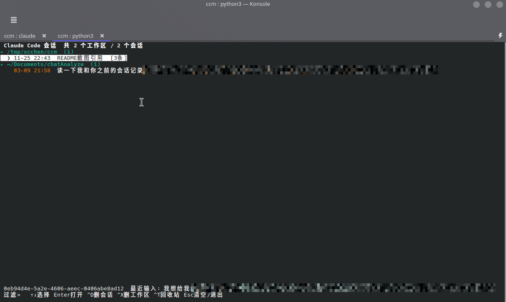
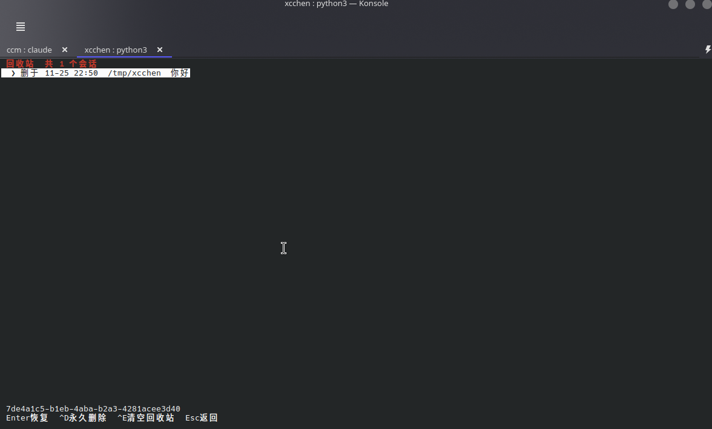

# ccm

在终端里浏览所有 Claude Code 会话，按工作区分组，选中后回车就在对应工作区里恢复这个会话。

> 非官方工具，与 Anthropic 无关。





## 功能

- 列出 `~/.claude/projects` 下的全部会话，按工作区分组，最近活跃的排在前面
- 每个会话显示最后活跃时间、标题（Claude Code 生成的标题，没有时用第一条输入）和消息数
- 输入文字即可过滤，匹配工作区路径、标题和最近一次输入
- 回车后切到该工作区目录，执行 `claude --resume <会话ID>`；claude 退出后终端仍在原来的目录
- 删除会话或清空某个工作区的会话，删除的内容先进回收站，可以恢复或永久删除
- 工作区目录已不存在时会标红提示

## 注意：默认跳过权限确认

`ccm` 打开会话时**默认会加上 `--dangerously-skip-permissions`**，claude 执行任何操作都不会再请求确认。如果不希望这样，删掉 `ccm` 末尾 `main()` 里插入这个参数的两行即可。

## 环境要求

- Linux、macOS 或 WSL（原生 Windows 的 Python 没有 `curses`，不支持）
- Python 3.8+，只用标准库
- 已安装 [Claude Code](https://docs.anthropic.com/en/docs/claude-code)，`claude` 命令在 PATH 中

## 安装

```sh
git clone https://github.com/weaksloth/ccm.git
cd ccm
./install.sh
```

默认装到 `~/.local/bin/ccm`，可以用 `CCM_INSTALL_DIR=/some/dir ./install.sh` 指定目录。如果该目录不在 PATH 中，按脚本提示加到 `~/.zshrc` 或 `~/.bashrc`。

也可以直接把 `ccm` 文件复制到 PATH 里的任意目录并加上执行权限。

## 使用

```sh
ccm                 # 打开会话列表
ccm --model opus    # 额外参数会原样传给 claude
```

### 会话列表

| 按键 | 作用 |
|---|---|
| ↑ / ↓ | 选择会话 |
| PgUp / PgDn | 翻页 |
| 直接输入 | 过滤 |
| Backspace | 删除一个过滤字符 |
| Enter | 在对应工作区恢复会话 |
| Ctrl-D | 删除选中的会话（移到回收站） |
| Ctrl-X | 删除该工作区下的全部会话（移到回收站） |
| Ctrl-T | 打开回收站 |
| Esc | 有过滤内容时清空，否则退出 |
| Ctrl-C | 退出 |

### 回收站

| 按键 | 作用 |
|---|---|
| Enter | 恢复到原位置（原位置已有同名文件时不恢复） |
| Ctrl-D | 永久删除选中的会话 |
| Ctrl-E | 清空回收站 |
| Esc | 返回会话列表 |

## 删除会动哪些文件

删除只处理 `~/.claude` 下 Claude Code 保存的会话数据，**不会动工作区目录本身**。每个会话会移走：

- `~/.claude/projects/<项目>/<会话ID>.jsonl`（会话记录）
- `~/.claude/projects/<项目>/<会话ID>/`（子代理等附属数据）
- `~/.claude/session-env/<会话ID>`
- `~/.claude/file-history/<会话ID>`

这些文件会移到 `~/.claude/ccm-trash/<删除时间>_<会话ID>/`，目录结构保持不变。项目的 `memory/` 目录不会被动。

不要删除正在运行中的会话，claude 会继续写入，留下不完整的记录。

## 兼容性说明

`ccm` 直接解析 Claude Code 在本地保存的 jsonl 会话文件。这个格式不是公开接口，Claude Code 升级后可能变化，导致标题显示不对或读不到会话。已测试版本：Claude Code 2.1.328。

## License

[MIT](LICENSE)
